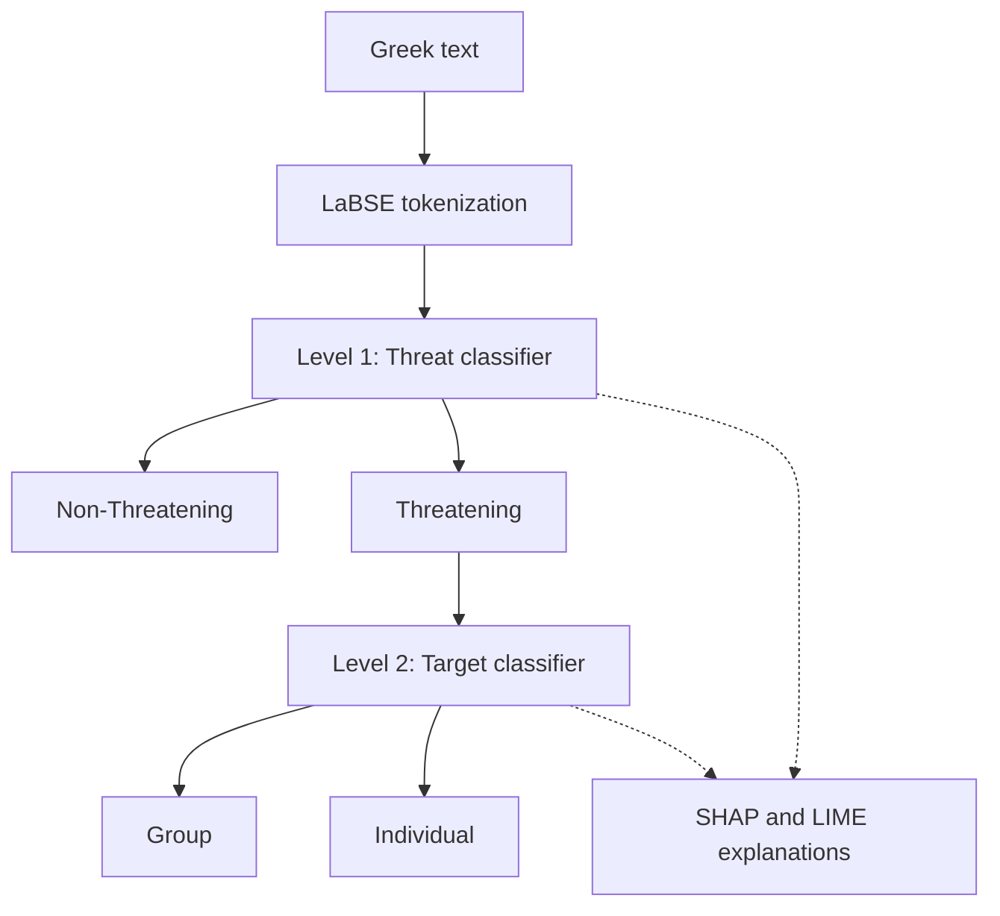

# Explainable Two-Level Greek Model for Threat Speech and Target Detection

[](LICENSE)
[](https://www.python.org/)
[](https://jupyter.org/)
[](https://pytorch.org/)
[](#research-status)

A Natural Language Processing project for **threat speech detection in Greek** and **identification of threat targets**, using fine-tuned **LaBSE** and explainable AI.

**[Tasks](#classification-tasks) · [Workflow](#workflow) · [Notebooks](#notebook-guide) · [Setup](#installation-and-setup) · [References](#references)**

## Research status

This repository accompanies a research manuscript **currently under review**. Its bibliographic citation and publication link will be added when available.

The seven studies listed under [References](#references) are related work on threat detection, target identification, hate speech, and explainable models. They provide research context and are separate from the main Greek manuscript.

## Classification tasks

| Level | Task | Label `0` | Label `1` |
| --- | --- | --- | --- |
| 1 | Threat speech detection | Non-Threatening | Threatening |
| 2 | Target identification | Group | Individual |

Target identification distinguishes between **group** and **individual** targets in threatening text. It does not identify a person's name or predict fine-grained community categories.

## Workflow



*Conceptual two-level decision flow. The notebooks train and evaluate the tasks separately; connecting their predictions into an automatic cascade requires an integration step.*

<!-- To use your own workflow picture, upload docs/workflow.png and replace the Mermaid block above with:

-->

## Model and explainability

The training notebooks use Hugging Face Transformers to fine-tune **LaBSE** (`setu4993/LaBSE`) for sequence classification.

| Component | Purpose |
| --- | --- |
| Threat classifier | Predict whether Greek text contains a threat |
| Target classifier | Predict whether the target is a group or an individual |
| SHAP | Inspect token contributions with text, bar, and waterfall visualizations |
| LIME | Explain individual predictions through local word contributions |
| Attention visualization | Explore token attention patterns in `Methodologies_1.ipynb` |

Explanations describe model behavior for the selected output. Their interpretation depends on the class mapping and the prediction being explained. Attention patterns are an exploratory view and should not be treated as equivalent to SHAP or LIME attribution.

<!-- After uploading a real explanation figure, you can add:
## Example prediction explanation


The visualization highlights the textual features that contribute to the selected prediction.
-->

## Notebook guide

The notebooks currently reside in the repository root.

| Notebook | Purpose |
| --- | --- |
| [LaBSE.ipynb](LaBSE.ipynb) | Threat classifier training and evaluation |
| [Methodologies_1.ipynb](Methodologies_1.ipynb) | Threat experiments, attention visualization, and SHAP analysis |
| [Target_identification-fine-tunning.ipynb](Target_identification-fine-tunning.ipynb) | Target classifier training, evaluation, and explanation experiments |
| [SHAP_LIME_(first_task)_.ipynb](<SHAP_LIME_(first_task)_.ipynb>) | SHAP and LIME for threat detection |
| [SHAP_LIME_(for_first_task_non_threat).ipynb](<SHAP_LIME_(for_first_task_non_threat).ipynb>) | Explanation examples for non-threatening text |
| [SHAP_LIME_(second_task)_.ipynb](<SHAP_LIME_(second_task)_.ipynb>) | SHAP and LIME for target identification |
| [SHAP_LIME_(for_second_task_Group_target).ipynb](<SHAP_LIME_(for_second_task_Group_target).ipynb>) | Explanation examples for group targets |

For a cleaner layout, these files can be moved together into `notebooks/`, with workflow images and explanation figures stored in `docs/`. If moved, update the links above and any Colab links to include `notebooks/`.

## Installation and setup

Clone the repository:

```bash
git clone https://github.com/MSIMALIK/Explainable-Two-Level-Greek-Model-for-Threat-Speech-and-Target-Detection-.git
cd Explainable-Two-Level-Greek-Model-for-Threat-Speech-and-Target-Detection-
```

Create an environment:

```bash
python -m venv .venv

# Linux / macOS
source .venv/bin/activate

# Windows PowerShell: use this activation command instead
# .venv\Scripts\Activate.ps1
```

Install the notebook dependencies:

```bash
python -m pip install "transformers==4.28.0" datasets torch tensorflow numpy pandas scikit-learn scipy matplotlib seaborn shap lime openpyxl jupyter
```

The notebooks specify **Transformers 4.28.0**. Other dependency versions are not fully locked, and a `requirements.txt` file is not currently included. The installation command documents the notebook dependencies; a complete environment lock is needed for exact reproduction.

Open the notebooks in **Jupyter Notebook** or **Google Colab**. Existing explanation cells that call `.cuda()` directly require a CUDA-capable runtime unless their device handling is adapted.

### Dataset setup

Prepare the following CSV files:

| Task | Required files | Required columns |
| --- | --- | --- |
| Threat detection | `train_dataset.csv`, `validation_dataset.csv`, `test_dataset.csv` | `Translated_Text`, `label` |
| Target identification | `train_target_dataset.csv`, `validation_target_dataset.csv`, `test_target_dataset.csv` | `Translated_Text`, `Targets (1-Individual, 0-Group)` |

The notebooks currently load these files from `/content/`. Dataset files are not included in the repository. Supply the files in that location when using Colab, or update the loading paths for your environment.

### Suggested execution order

1. Prepare the appropriate train, validation, and test CSV files.
2. Run `LaBSE.ipynb` for threat detection and `Target_identification-fine-tunning.ipynb` for target identification.
3. Review evaluation outputs for each task separately.
4. Run the relevant explanation notebook and verify which trained model and class output it explains.

Some explanation notebooks include their own training cells. Check those cells before running them if you intend to explain an existing checkpoint.

For target explanations, use the label order:

```python
class_names = ['Group', 'Individual']
```

In particular, review the generic LIME labels retained in `SHAP_LIME_(second_task)_.ipynb` and `Target_identification-fine-tunning.ipynb` before interpreting their target explanations.

## Evaluation

The notebooks report **accuracy**, **weighted precision**, **weighted recall**, **weighted F1-score**, and **confusion-matrix counts**. Evaluate threat detection and target identification as separate tasks.

To reproduce an experiment, retain the data partitions, model checkpoint, random seed, preprocessing choices, hyperparameters, and package versions alongside the outputs. Results from related papers concern different datasets or tasks and should not be presented as results of this Greek repository.

## Related research

Threat detection and target identification in Urdu [2, 3] and multilingual threat classification [4] provide relevant methodological context. Further related work covers community targets in hate speech [1], violence incitation [5, 6], and explainable hybrid hate-speech models [7].

## Citation

The main Greek manuscript is **under review**. Its citation will be added when the authors make the bibliographic details available. Cite the related studies below when discussing or using their specific methods, datasets, or findings.

## References

1. **Muhammad Shahid Iqbal Malik, Aftab Nawaz, and Mona Mamdouh Jamjoom.** (2024). [Hate Speech and Target Community Detection in Nastaliq Urdu Using Transfer Learning Techniques](https://doi.org/10.1109/ACCESS.2024.3444188). *IEEE Access*, **12**, 116875–116890.

2. **Muhammad Shahid Iqbal Malik.** (2024). [Threatening Expression and Target Identification in Under-Resource Languages Using NLP Techniques](https://doi.org/10.1007/978-3-031-54534-4_1). In *Analysis of Images, Social Networks and Texts*, AIST 2023, Lecture Notes in Computer Science, **14486**, 3–17. Springer.

3. **Muhammad Shahid Iqbal Malik, Uswa Cheema, and Dmitry I. Ignatov.** (2023). [Contextual Embeddings based on Fine-tuned Urdu-BERT for Urdu threatening content and target identification](https://doi.org/10.1016/j.jksuci.2023.101606). *Journal of King Saud University – Computer and Information Sciences*, **35**(7), 101606.

4. **Muhammad Rehan, Muhammad Shahid Iqbal Malik, and Mona Mamdouh Jamjoom.** (2023). [Fine-Tuning Transformer Models Using Transfer Learning for Multilingual Threatening Text Identification](https://doi.org/10.1109/ACCESS.2023.3320062). *IEEE Access*, **11**, 106503–106515.

5. **Rameesha Zia and Muhammad Shahid Iqbal Malik.** (2026). [Two-level violence incitation detection in urdu using explainable hybrid deep learning model](https://doi.org/10.1016/j.asoc.2026.115679). *Applied Soft Computing*, **201**, 115679.

6. **Muhammad Shahid Khan, Muhammad Shahid Iqbal Malik, and Aamer Nadeem.** (2024). [Detection of violence incitation expressions in Urdu tweets using convolutional neural network](https://doi.org/10.1016/j.eswa.2024.123174). *Expert Systems with Applications*, **245**, 123174.

7. **Rameesha Zia and Muhammad Shahid Iqbal Malik.** (2026). [An Explainable DistilBERT-BiLSTM-Attention Framework for Binary and Multi-Class Hate Speech Detection](https://arxiv.org/abs/2609.28703). *arXiv preprint*, arXiv:2609.28703.

## Content notice

The data and notebook examples may contain threatening, abusive, or sensitive Greek expressions used for training and evaluation. This material is included for research and academic purposes.

## License

Project code is licensed under the **MIT License**. See [`LICENSE`](LICENSE). Refer to the relevant sources for the terms applying to external datasets, pretrained models, and papers.

## Author

**Muhammad Shahid Iqbal Malik**  
GitHub: [@MSIMALIK](https://github.com/MSIMALIK)


